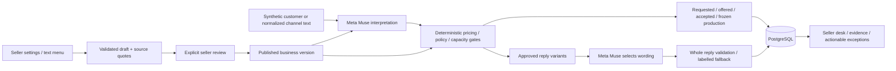

# Architecture

Next.js is a responsive seller workspace and runtime same-origin API proxy. FastAPI owns business rules. SQLAlchemy and Alembic own PostgreSQL persistence. No new application framework, payment service or distributed queue was added.

A business row lock serializes customer turns and capacity reservations across processes. Acceptance rechecks the active version, complete specification, fixed amount, lead time, date and shared capacity. Offers do not reserve capacity. Unique message IDs and optimistic store versions protect duplicate and stale writes. Messages, events, the complete sourced state and order projection commit together.

Quotes snapshot their published configuration. Accepted terms and production instructions are frozen historical records. Publishing changes future quotes and invalidates stale acceptance; it does not rewrite existing commitments. Legacy M2 history is read with compatible default fields and historical evidence support, without rewriting old audit events or inventing missing provenance.

Muse proposes interpretation and draft settings. It cannot directly publish settings, choose prices, reserve slots, verify payment or start production. Customer and seller text are untrusted executable content; supported commercial conditions become typed data, never code. A seller explicitly approves configuration authority.

The Instagram webhook verifies and enqueues quickly under a short account lock. The explicit inbox worker then enters the existing business transaction and prepares a held reply. This separation prevents slow model calls from blocking webhook acknowledgement. Live account routing comes from the signed recipient and registered ownership, never a client business header. Synthetic replay and Scenario Lab use separate business namespaces.

The outbound transport has no automatic runtime trigger. It marks a reply `delivery_unknown` before any authorized external effect, avoiding repeated delivery after a crash or uncertain result. No live send was authorized or performed. OAuth and production tenant security are not implemented.

## Files

- `backend/app/configuration.py`: draft extraction, validation, review and publishing.
- `backend/app/engine.py`, `replies.py`, `provider.py`: interpretation, deterministic state and validated composition.
- `backend/app/database.py`, `store.py`, `alembic/versions`: ownership, transactions, projections and schema.
- `backend/app/scenarios.py`: invariant checks against persisted agent results.
- `backend/app/instagram.py`, `instagram_worker.py`: signed inbox, isolation, processing and held transport contract.
- `frontend/app/settings`, `overview`, `lab`, `channels`: seller experience.
- `artifacts/m3`, `artifacts/m4`: synthetic verification evidence, not private DMs.
